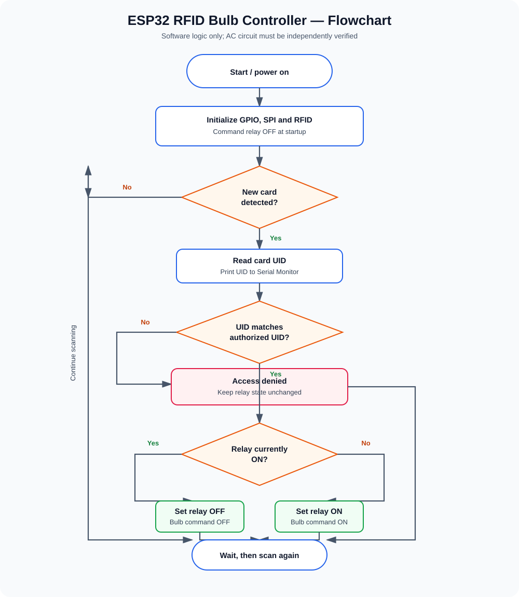
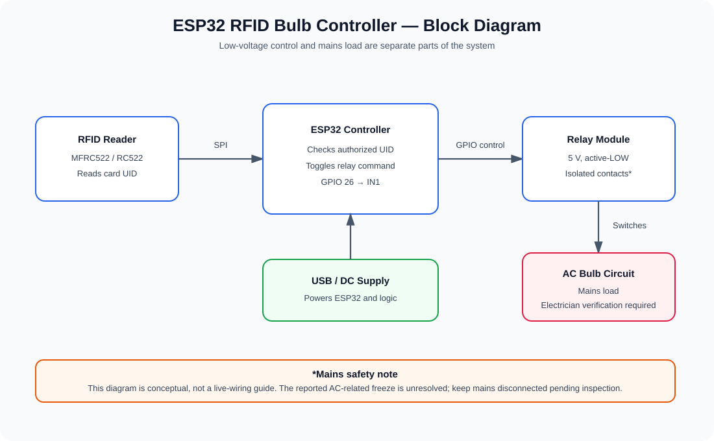

# ESP32 RFID Bulb Controller

## Project objective

Use an ESP32 and an MFRC522 RFID reader to toggle a relay, which controls an AC bulb through the relay's properly rated and professionally verified contact circuit.

- Any teacher card whose UID is listed in `AUTHORIZED_UIDS` → toggles the relay/bulb command.
- Scan any authorized teacher card again → toggles it back OFF.
- Multiple teachers can each use their own registered card; an unregistered card does not change the state.
- Startup software command → relay OFF / bulb OFF.


## Hardware

- ESP32 Dev Module
- MFRC522 RFID reader
- 5 V relay module, active-LOW input, Relay 1 / IN1
- One RFID card per authorized teacher (multiple cards supported in software)
- USB cable and jumper wires
- Bulb and a properly rated, enclosed mains switching installation, inspected by a qualified electrician

## Low-voltage wiring

### MFRC522 → ESP32

| MFRC522 pin | ESP32 pin |
|---|---|
| SDA / SS | GPIO 5 |
| SCK | GPIO 18 |
| MOSI | GPIO 23 |
| MISO | GPIO 19 |
| RST | GPIO 22 |
| 3.3V | 3V3 |
| GND | GND |
| IRQ | Not connected |

The RC522 pin labelled `SDA` is used as SPI chip-select in this setup. Power the RC522 from 3.3 V only.

### Relay control pins → ESP32

Assuming the module labels are `VCC`, `GND`, `IN1`, `IN2` and the module supports 5 V:

| Relay control pin | Connection |
|---|---|
| VCC | ESP32 VIN/5V, only if module is rated for 5 V |
| GND | ESP32 GND |
| IN1 | ESP32 GPIO 26 |
| IN2 | Unused |

The sketch assumes active-LOW logic: LOW energizes the relay; HIGH de-energizes it. If the module has JD-VCC or different labels, use its exact manufacturer documentation.

## Relay and bulb function

The code controls the relay only. The bulb turns ON/OFF only if the bulb is connected to the relay contacts correctly and the relay is rated for that load. The actual COM/NO/NC terminal positions must be identified from labels/datasheet, not guessed. Because the current installation freezes when AC is connected, this document does not provide a live mains wiring procedure. A qualified electrician must inspect the complete mains circuit before it is energized. Never use a breadboard for mains voltage.

## Add multiple teachers' RFID cards

The sketch supports multiple authorized card UIDs. To register each teacher's card:

1. Keep the mains circuit disconnected and power the ESP32 over USB.
2. Upload the sketch and open Serial Monitor at **115200 baud**.
3. Scan a teacher's card. Read the printed `Card UID:` value, for example `11 22 33 44` (example only).
4. In `src/esp32_rfid_bulb_controller.ino`, find `AUTHORIZED_UIDS`.
5. Add one entry per teacher using the UID bytes in hexadecimal, with `0x` before each byte. Example:

   ```cpp
   const AuthorizedCard AUTHORIZED_UIDS[] = {
     {4, {0x72, 0x2B, 0xCE, 0x5C}}, // Existing authorized card
     {4, {0x11, 0x22, 0x33, 0x44}}, // EXAMPLE ONLY: replace with the teacher's actual UID
     {4, {0xAA, 0xBB, 0xCC, 0xDD}}, // EXAMPLE ONLY: replace with another actual UID
   };
   ```

6. Each entry's first number is the UID length (4 in these examples). Use the exact number of bytes shown by Serial Monitor and enter all bytes in order.
7. Save and upload the sketch again. Repeat the USB-only test with each registered card and one unregistered card.

Do not leave example UIDs in the list as if they were real teacher cards. The existing known UID `72 2B CE 5C` is the only confirmed card in this project so far. UID-only RFID access can be cloned and is not strong security.

## Arduino IDE setup

1. Install Arduino IDE.
2. Install the ESP32 board package by Espressif Systems in Boards Manager.
3. Install the `MFRC522` library in Library Manager.
4. Open `src/esp32_rfid_bulb_controller.ino`.
5. Select **ESP32 Dev Module** and the correct serial port.
6. Upload the sketch.
7. Open Serial Monitor at **115200 baud**.
8. Test the RFID and relay with USB power only and all mains wiring disconnected.

## Expected serial messages

```text
ESP32 RFID Bulb Controller
RC522 version: 0xB2
Startup command: relay OFF / bulb OFF
Present authorized card to toggle bulb command.
Card UID: 72 2B CE 5C
ACCESS GRANTED - RELAY ON - BULB COMMAND ON
Card UID: 72 2B CE 5C
ACCESS GRANTED - RELAY OFF - BULB COMMAND OFF
```

## Flowchart and diagrams

The diagrams below are SVG images and should render directly in GitHub's README preview. Open the SVG links if your viewer does not display embedded images.

### Flowchart



[Open flowchart SVG](docs/flowchart.svg) · [Editable Mermaid source](docs/flowchart.mmd)

### System block diagram



[Open block diagram SVG](docs/block-diagram.svg) · [Editable Mermaid source](docs/block-diagram.mmd)

- [Wiring notes](docs/wiring.md)
- [Testing and troubleshooting](docs/testing-and-troubleshooting.md)

## Known issue / safety status

The user's low-voltage RFID and relay tests were stable over USB alone. With AC mains involved, the controller froze even when the relay was OFF; after the first scan switched the bulb ON, the relay and bulb stayed ON and RFID stopped responding. EN/RESET did not recover it; USB power cycling did. Cause is unknown. Do not reconnect AC until a qualified electrician inspects the installation. Software cannot fix unsafe wiring or guarantee fail-off behavior during a controller hang.

## Security limitations

This prototype authorizes by card UID only. Some RFID tags can be cloned; UID checking is not strong authentication and should not be relied on for high-security or safety-critical applications.
